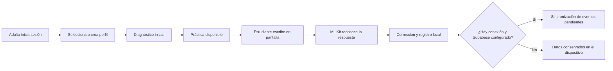

# K-Mat IA

K-Mat IA es una aplicación Android de apoyo al aprendizaje matemático para estudiantes de 1.º y 2.º básico. El prototipo combina perfiles de estudiantes, diagnóstico inicial, práctica con escritura digital y herramientas para responsables, docentes y administradores.

La respuesta manuscrita se captura en un lienzo y se reconoce con **Google ML Kit Digital Ink Recognition**. El reconocimiento procesa trazos realizados con el dedo o un lápiz digital; no usa la cámara ni OCR de fotografías.

## Estado actual del prototipo

| Módulo | Estado | Alcance disponible |
| --- | --- | --- |
| Acceso de usuarios | Implementado | Inicio de sesión y registro público de cuentas de responsable o docente mediante Supabase Auth. Los estudiantes usan perfiles vinculados a un adulto y no tienen contraseña propia. |
| Perfiles de estudiantes | Implementado | Creación, consulta, selección y eliminación de perfiles de 1.º y 2.º básico. El responsable puede vincular un perfil a una sala con el código entregado por el docente. |
| Diagnóstico inicial | Implementado | Presenta preguntas desde el banco disponible, adapta algunas preguntas de seguimiento por eje y muestra un resumen del resultado. Su alcance depende de los ejercicios configurados. |
| Práctica matemática | MVP funcional | Permite resolver ejercicios disponibles con trazos en pantalla, reconocer la respuesta, mostrar el resultado y registrar intentos. El ejercicio de demostración `1 + 1` forma parte del catálogo actual; la cobertura de contenidos todavía es acotada. |
| Progreso del estudiante | Implementado | Consulta resultados por materia, respuestas correctas e incorrectas, tiempo promedio e historial disponible. |
| Espacio docente | Implementado | Crear salas, compartir códigos de unión, consultar estudiantes vinculados, revisar progreso individual y grupal, asignar actividades de refuerzo disponibles y exportar reportes individuales en PDF. |
| Administración | Implementado parcialmente | Consultar cuentas, cambiar entre roles de responsable y docente, enviar instrucciones de cambio de contraseña y eliminar cuentas. |
| Persistencia local y uso sin conexión | Implementado para la práctica | Room conserva ejercicios disponibles, sesiones e intentos en el dispositivo. La práctica sin conexión requiere que los datos necesarios y el modelo de escritura estén disponibles localmente. |
| Sincronización | Implementación disponible, dependiente del entorno | WorkManager envía eventos pendientes a una Edge Function de Supabase cuando hay conexión y el backend está configurado. Si el envío falla, los datos locales se conservan para reintentar. |
| Adaptación del aprendizaje | Parcial | El diagnóstico adapta preguntas de seguimiento. La adaptación continua de toda la trayectoria, la selección amplia de contenidos y el refuerzo automático aún no están completos. |

Las pantallas de preferencias y algunos flujos complementarios muestran la navegación prevista y todavía no representan funcionalidades completas. El prototipo tampoco debe interpretarse como un catálogo amplio de ejercicios ni como un sistema de adaptación pedagógica integral.

## Flujo principal



## Arquitectura

La aplicación Android está organizada por capas:

```text
Interfaz Jetpack Compose → ViewModels → Casos de uso → Repositorios
                                                   ├─ Room (persistencia local)
                                                   ├─ ML Kit Digital Ink (reconocimiento de trazos)
                                                   └─ Supabase (autenticación y servicios remotos)
```

Estructura principal del repositorio:

```text
android-app/    Aplicación Android en Kotlin, interfaz Compose y pruebas instrumentadas
supabase/       Migraciones SQL, Edge Function y documentación de datos
Mockups/        Referencias visuales de las pantallas
```

## Tecnologías

- Kotlin, Jetpack Compose y Material 3.
- Android SDK 35; mínimo Android 8.0 (API 26).
- Room para persistencia local.
- WorkManager para sincronización diferida.
- Google ML Kit Digital Ink Recognition para reconocer trazos manuscritos.
- Supabase Auth, PostgreSQL con RLS y Edge Functions.

## Ejecutar la aplicación

1. Abre la carpeta [android-app](android-app) en Android Studio.
2. Usa el JDK integrado de Android Studio y sincroniza Gradle.
3. Ejecuta la aplicación en un dispositivo o emulador con Android 8.0 o superior.

Para probar autenticación, perfiles y servicios remotos, configura Supabase. La práctica puede guardar resultados localmente; el acceso a los servicios remotos y la sincronización requieren conectividad y la configuración correspondiente. Consulta la [guía de Android](android-app/README.md) y la [documentación de la base de datos](supabase/DOCUMENTACION_BASE_DE_DATOS.md).

## Configuración de Supabase

Las migraciones de [supabase/migrations](supabase/migrations) se aplican en orden cronológico:

1. `20260930160000_kmat_schema.sql`
2. `20261001235500_area_usuario_autenticado.sql`
3. `20261002001000_registro_responsable.sql`
4. `20261018000000_nombre_usuario_autenticado.sql`
5. `20261018001000_saludo_estudiante_vinculado.sql`
6. `20261020001000_gestion_perfiles_responsable.sql`
7. `20261020002000_niveles_basica.sql`
8. `20261024001000_listar_cuentas_administrador.sql`
9. `20261024002000_listar_estudiantes_responsable_seguro.sql`
10. `20261024003000_permisos_lectura_perfiles.sql`
11. `20261024004000_eliminar_perfil_responsable.sql`
12. `20261024005000_borrado_definitivo_estudiante.sql`
13. `20261024006000_gestion_cuentas_admin.sql`
14. `20261025001000_herramientas_docente.sql`
15. `20261025002000_progreso_docente_por_sesion.sql`
16. `20261106001000_sincronizacion_multidispositivo.sql`
17. `20261110001000_progreso_docente_por_materia.sql`
18. `20261110002000_nivel_desempeno_reporte_docente.sql`
19. `20261110003000_eliminar_sala_docente.sql`
20. `20261112001000_registro_roles_y_cambio_admin.sql`
21. `20261116001000_perfil_automatico_cambio_rol.sql`

El archivo [poblacion_inicial_mvp.sql](supabase/poblacion_inicial_mvp.sql) agrega roles, catálogos y datos de demostración. Antes de ejecutarlo, crea en Supabase Authentication los usuarios de ejemplo indicados en ese archivo.

Para desarrollo, define las propiedades de conexión en `%USERPROFILE%\.gradle\gradle.properties`:

```properties
SUPABASE_URL=https://TU_PROYECTO.supabase.co
SUPABASE_ANON_KEY=tu_clave_anon_publica
SUPABASE_EXERCISE_VERSION_ID=uuid_de_la_version_publicada_del_ejercicio
```

La clave `service_role` pertenece exclusivamente al entorno de la Edge Function; no debe incluirse en la aplicación Android ni subirse al repositorio.

## Pruebas instrumentadas

El repositorio contiene pruebas instrumentadas para perfiles, espacio docente, diagnóstico, práctica, reconocimiento de escritura y audio de cierre de sesión. Para ejecutarlas desde `android-app`:

```powershell
.\gradlew.bat connectedDebugAndroidTest
```

Las pruebas instrumentadas requieren un emulador o dispositivo Android conectado.

## Próximos avances

- Ampliar el catálogo de ejercicios y contenidos disponibles.
- Completar la adaptación de la trayectoria de aprendizaje y los refuerzos.
- Ampliar las herramientas de responsables y las operaciones de administración de usuarios.
- Validar la sincronización integral en un entorno Supabase desplegado y con varios perfiles por cuenta.
- Completar preferencias, pausas activas y demás flujos complementarios.

## Documentación relacionada

- [Arquitectura Android](android-app/docs/ARQUITECTURA.md)
- [Autenticación](android-app/docs/AUTENTICACION.md)
- [Operación sin conexión y sincronización](android-app/docs/OFFLINE_FIRST.md)
- [Navegación](android-app/docs/NAVEGACION.md)
- [Modelo y operación de base de datos](supabase/DOCUMENTACION_BASE_DE_DATOS.md)
